# Photo Session Booking System
## Assignment 5 — Strategy Pattern

**Student:** Aida Khalila

## Project Description
This Java project demonstrates the Strategy Design Pattern
using a Photo Session Booking System.

The application contains two strategy families:
- Pricing Strategy
- Photographer Selection Strategy

## Pricing Strategies
- HourlyPricing — calculates the hourly price.
- PackagePricing — calculates the package price.
- DistancePricing — calculates the price using distance data.

## Photographer Strategies
- ExperienceStrategy — selects the most experienced photographer.
- AvailabilityStrategy — selects the earliest available photographer.
- SpecializationStrategy — selects a photographer by specialization.

## Design Pattern Structure
Each strategy family contains:
- Strategy interface
- Three concrete strategies
- Context with runtime switching
- Automatic Selector

## External Data
DistancePricing uses the DistanceProvider interface.
Tests use a fake distance provider.

## Testing
The project uses JUnit 5:
- Unit tests for concrete strategies
- Selector tests
- Context switching tests
- Parameterized tests

## Strategy vs State vs Template Method

Strategy defines interchangeable algorithms using composition.
The client can select a different algorithm at runtime.

State changes an object's behavior based on its internal state.
State transitions are part of the object's lifecycle.

Template Method defines an algorithm structure in a base class.
Subclasses customize individual steps through inheritance.

## Refactoring History
Before: pricing calculations used if-else statements.

After: pricing algorithms were extracted into separate
Strategy classes.

Before commit: ADD_LINK_HERE

After commit: ADD_LINK_HERE

## How to Run
Run Main.java in IntelliJ IDEA.

## How to Test
Open Maven → Lifecycle → test.

## UML Class Diagram

The diagram shows two Strategy families:
Pricing and Photographer Selection.

```mermaid
classDiagram
direction TB

namespace Pricing {
    class PricingStrategy {
        <<interface>>
        +calculatePrice(hours, distance) double
    }
    class HourlyPricing
    class PackagePricing
    class DistancePricing
    class PricingContext {
        -strategy: PricingStrategy
        +setStrategy(strategy)
        +calculatePrice(hours, distance) double
    }
    class PricingSelector {
        +selectStrategy(hours, distance) PricingStrategy
    }
    class DistanceProvider {
        <<interface>>
        +getDistanceKm() double
    }
    class FixedDistanceProvider
}

namespace PhotographerSelection {
    class PhotographerStrategy {
        <<interface>>
        +selectPhotographer(photographers, sessionType) Photographer
    }
    class ExperienceStrategy
    class AvailabilityStrategy
    class SpecializationStrategy
    class PhotographerContext {
        -strategy: PhotographerStrategy
        +setStrategy(strategy)
        +selectPhotographer(photographers, sessionType) Photographer
    }
    class PhotographerSelector {
        +selectStrategy(sessionType, urgent) PhotographerStrategy
    }
    class Photographer
}

PricingStrategy <|.. HourlyPricing
PricingStrategy <|.. PackagePricing
PricingStrategy <|.. DistancePricing
PricingContext --> PricingStrategy
PricingSelector ..> PricingStrategy

DistanceProvider <|.. FixedDistanceProvider
DistancePricing --> DistanceProvider

PhotographerStrategy <|.. ExperienceStrategy
PhotographerStrategy <|.. AvailabilityStrategy
PhotographerStrategy <|.. SpecializationStrategy
PhotographerContext --> PhotographerStrategy
PhotographerSelector ..> PhotographerStrategy
PhotographerStrategy ..> Photographer
```

